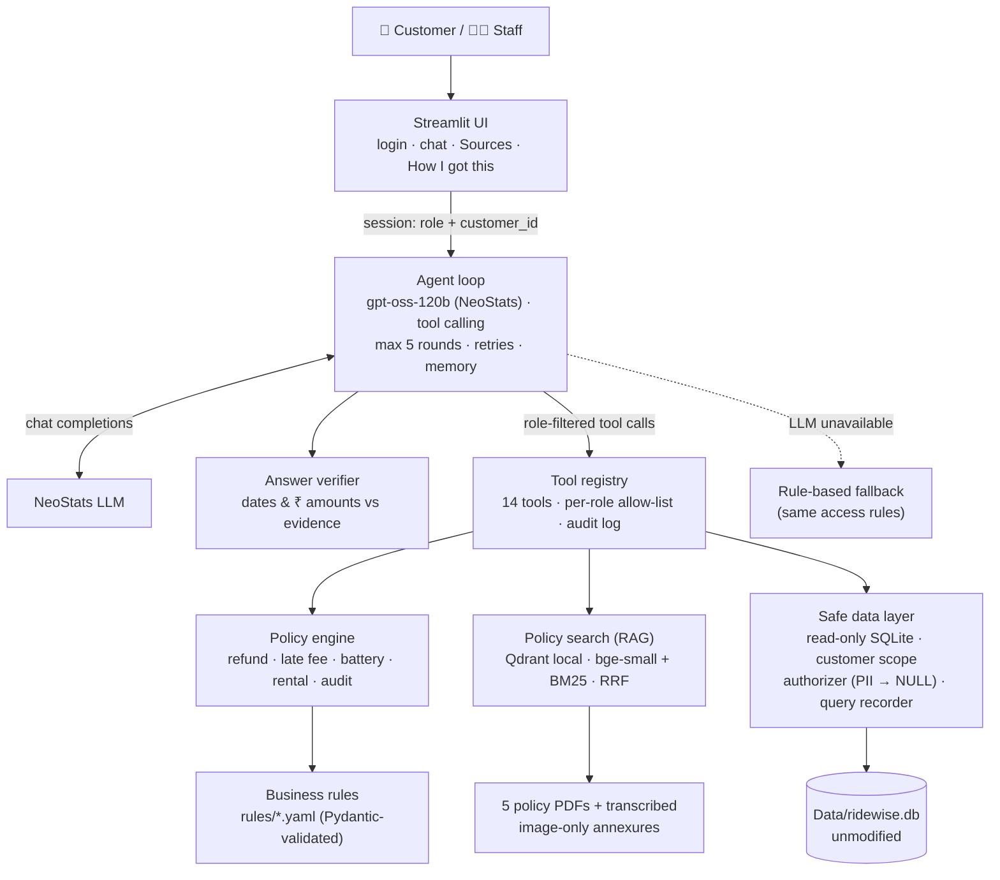

# RideWise Assist

A conversational assistant for **RideWise**, a two-wheeler and EV rental company in Bengaluru. It answers
questions from **customers** and **support staff** using RideWise's operational database (`ridewise.db`)
and its five policy documents. Answers are correct, scoped to what each user may see, and verifiable.

> **Design principle:** the LLM never does arithmetic, never decides whose data it may see, and never
> answers without a source. Amounts come from a tested Python policy engine. Access rules are enforced in
> code. Every answer shows its sources and the exact SQL that produced it.

---

## Contents
1. [Features](#features)
2. [Quick start (≤ 10 minutes)](#quick-start--10-minutes)
3. [Configuration (environment variables)](#configuration-environment-variables)
4. [Demo logins](#demo-logins)
5. [Architecture](#architecture)
6. [How a question is answered](#how-a-question-is-answered)
7. [Security & data protection](#security--data-protection)
8. [Project structure](#project-structure)
9. [Testing & red-teaming](#testing--red-teaming)
10. [Changing business rules (adaptability)](#changing-business-rules-adaptability)
11. [Troubleshooting](#troubleshooting)
12. [Known limitations](#known-limitations)

---

## Features

| | Customers | Support staff |
|---|---|---|
| Sign-in | Customer ID + registered mobile number (as password) | Staff ID + password (salted PBKDF2 hashes) |
| Own bookings, payments, refunds, charges | ✅ (own account only) | ✅ any booking |
| Refund calculation (correct policy version v1/v2) | ✅ incl. "what if I cancel at…" | ✅ |
| Late-fee / battery-fee / damage explanation | ✅ | ✅ |
| Rental quotes (rental + GST + deposit) | ✅ | ✅ |
| Policy questions with PDF citations | ✅ | ✅ |
| Customer lookup (contact details masked) | — | ✅ |
| Damage claims, refund audit | — | ✅ |
| Operational analytics (guarded read-only SQL) | — | ✅ |

**Every answer includes**
- **Sources**, split into *Policy documents (PDF)* (document, section, page, file name) and *Database records
  (ridewise.db)* (table + record IDs).
- **How I got this**: each lookup in plain language, the calculation steps, and the **exact SQL executed**.
  Paste it into DB Browser for SQLite to get the same rows.
- An **automatic check**: every date and ₹ amount in the answer is compared with the records before it is shown.

**Resilience:** if the LLM is slow or unavailable, a rule-based fallback still answers booking, refund
and charge questions straight from the records, with the same access rules.

---

## Quick start (≤ 10 minutes)

**Prerequisites:** Python **3.10+** (tested on 3.12) and Git. No database server or Docker needed.

```bash
# 1. Clone
git clone https://github.com/Kiranrossi/ridewise-bike-agent.git
cd ridewise-bike-agent

# 2. Create and activate a virtual environment
python3 -m venv .venv
source .venv/bin/activate            # Windows: .venv\Scripts\activate

# 3. Install dependencies (~2–3 minutes; no PyTorch)
pip install -r requirements.txt

# 4. Configure the NeoStats LLM credentials
cp .env.example .env                 # Windows: copy .env.example .env
#    then edit .env and fill in LLM_BASE_URL, LLM_API_KEY and LLM_MODEL

# 5. Run
streamlit run app.py
```

Open **http://localhost:8501** and sign in with one of the [demo logins](#demo-logins).

On the **first run** the app downloads the embedding models (~150 MB, once) and builds the policy search
index (~10 s). Later runs start immediately. To build the index ahead of time:
`python -m ridewise.ingest`.

**Optional checks**
```bash
python scripts/smoke_test_llm.py     # verifies the LLM endpoint and tool calling
pytest                               # 226 offline tests (no LLM calls)
```

---

## Configuration (environment variables)

All settings are read from `.env`, which is **never committed**. `.env.example` lists every variable with
placeholders.

| Variable | Required | Default | Description |
|---|---|---|---|
| `LLM_BASE_URL` | ✅ | — | NeoStats OpenAI-compatible endpoint, e.g. `https://…/openai/v1/` |
| `LLM_API_KEY` | ✅ | — | API key provided by NeoStats |
| `LLM_MODEL` | ✅ | — | Model / deployment name provided by NeoStats |
| `LLM_TIMEOUT_SECONDS` | | `60` | Per-request timeout |
| `LLM_REASONING_EFFORT` | | `medium` | `low` / `medium` / `high` for gpt-oss |
| `LLM_TEMPERATURE` | | `0.2` | Sampling temperature |
| `EMBEDDING_MODEL` | | `BAAI/bge-small-en-v1.5` | Local FastEmbed model (swap if NeoStats provides one) |
| `DB_PATH` | | `Data/ridewise.db` | Provided SQLite database (opened read-only) |
| `INDEX_PATH` | | `index` | Local Qdrant index folder (generated) |
| `AUTH_MODE` | | `strict` | `strict` = customer ID + mobile number; `demo` = customer ID only |

If no API key is configured, the app still starts in **limited mode** (rule-based answers only).

---

## Demo logins

**Support staff**: click **Support staff sign-in** (top right).

| Staff ID | Password | Name / team |
|---|---|---|
| `agent01` | `RideWise@2026` | Priya Menon, Support Desk |
| `hubops01` | `RideWise@2026` | Arjun Rao, Hub Operations |

Add staff users with `python scripts/add_staff_user.py <id> "<Name>" "<Team>"`. Passwords are stored only
as salted PBKDF2 hashes in `config/staff_users.json`.

**Customers**: the password is the registered mobile number.

| Customer ID | Password | Tier / KYC | Good for testing |
|---|---|---|---|
| `CUST0001` | `9845012345` | GOLD / Verified | Late return within GOLD grace (B-0001); upcoming booking |
| `CUST0064` | `6551728940` | GOLD / Verified | Refund owed but not yet issued (B-1729, v2, two instalments) |
| `CUST0047` | `7929803547` | STANDARD / Verified | Refund pending after a failed + retried payment (B-1709) |
| `CUST0013` | `7866150778` | STANDARD / Verified | Disputed damage claim DMG0003 (B-0412) |
| `CUST0150` | `9382031781` | SILVER / Verified | B-1165: booked 1 Jul IST / 30 Jun UTC → policy v2 |
| `CUST0178` | `9692081170` | STANDARD / Verified | Upcoming booking with payment pending (B-1700) |
| `CUST0005` | `9632056789` | STANDARD / Verified | Ongoing rental |
| `CUST0002` | `9886023456` | SILVER / Verified | EV returned below 10% battery |
| `CUST0106` | `8669716895` | SILVER / Verified | Most bookings in the system |
| `CUST0042` | `6845642871` | STANDARD / **Pending** | KYC pending with an upcoming booking |
| `CUST0008` | `9739089012` | STANDARD / **Rejected** | KYC rejected |

**Things to try**
- *Customer:* "Where's my refund?" → "Why only 75%?" → "What if I had cancelled 3 days earlier?"
- *Customer:* "Show me booking B-0412" (someone else's: refused, nothing revealed)
- *Customer:* "If I return a Classic 350 1 hour 10 minutes late, what's the fee?"
- *Staff:* "Which cancelled bookings still have a refund owed?" → "Revenue by hub for September 2026"
- *Staff:* "Details of damage report DMG0009" (contains planted instructions, which are ignored)

---

## Architecture



**Who decides what**

| Question type | Answered by | Never by |
|---|---|---|
| Amounts, percentages, eligibility, dates | `policy_engine.py` + `rules/*.yaml` | LLM arithmetic |
| Facts about bookings, payments, customers | `db.py` (scoped, read-only) | LLM memory |
| Policy wording, definitions, procedures | `retrieval.py` with PDF citations | model's general knowledge |
| Management analytics | guarded SQL (staff only) | — |
| Choosing tools, phrasing, follow-ups | LLM | — |

**Technology choices**

| Layer | Choice | Why |
|---|---|---|
| UI | Streamlit | Fast to build, chat primitives, testable with `AppTest` |
| LLM | NeoStats `gpt-oss-120b` via `openai` SDK | Mandated; strong at tool calling |
| Orchestration | Plain Python loop | Fully explainable; no framework magic |
| Vector store | Qdrant (local mode) | No server; built-in dense + BM25 hybrid and metadata filters |
| Embeddings | `bge-small-en-v1.5` via FastEmbed | Strong for its size; ONNX (no PyTorch) keeps setup fast |
| PDF parsing | PyMuPDF | Text + tables as Markdown |
| Validation | Pydantic | YAML rules and tool arguments |
| Resilience | tenacity | Retries with backoff |

---

## How a question is answered

*"How much will I get back if I cancel B-1729?"* (customer CUST0064)

1. **UI** passes the session `{role: customer, customer_id: CUST0064}`. The ID comes from the login, never the chat.
2. **Agent** builds the system prompt (role rules, current time in IST, an account snapshot fetched by code)
   and offers the model **only customer tools**.
3. The model calls `refund_quote(booking_id="B-1729")`. Note there is **no customer_id argument**.
4. The tool loads the booking through `CustomerData("CUST0064")`, which enforces ownership in SQL. The
   **policy engine** picks the version by booking time (v2), the slab by hours before pickup (46 h 30 min →
   75%) and applies it to successful payments only. It returns the amount, GST, rule, source and steps.
5. The model writes the answer from the tool result. The **verifier** checks every date and ₹ amount against
   the evidence and triggers one automatic rewrite if anything doesn't match.
6. The UI shows the answer, **Sources** (RW-POL-03 Annexure 1 p.2 · `ridewise.db` bookings B-1729, payments
   PAY03157, PAY03226) and **How I got this** (steps + SQL).

If another customer asked, step 4 would return "No booking B-1729 was found on your account", exactly like
a booking that doesn't exist.

---

## Security & data protection

| Risk | Control (enforced in code) |
|---|---|
| Customer sees another customer's data | Session-bound `CustomerData`; every query filtered by the session `customer_id`; foreign bookings indistinguishable from missing ones |
| Impersonation in chat ("I'm CUST0005") | Identity only from login; tools take no `customer_id` argument; unknown arguments dropped |
| Wrong role uses a tool | Role allow-list from `rules/access_policy.yaml`; tools never offered to the wrong role and re-checked at execution |
| Database modification | `mode=ro` connection + `PRAGMA query_only` + SQLite authorizer denying all writes, PRAGMA and ATTACH |
| Bulk personal-data extraction by staff | Authorizer returns phone/email/licence/DOB/remarks as NULL in SQL (even via aliases, subqueries or `SELECT *`); masked views in tools |
| Prompt injection via data | Free text scrubbed of emails/phones and wrapped as `<untrusted_data>`; system rule to never follow it |
| Jailbreak prompts | Platform content filter handled as a polite refusal; system prompt never revealed |
| SQL injection | Parameterised queries everywhere; strict ID formats at login |
| Brute-force login | Generic failure message, constant-time hash comparison, lockout after 5 failures |
| Secrets | `.env` git-ignored; only `.env.example` committed |
| Hallucinated figures | Calculator-only numbers + answer verifier; unverifiable answers carry a visible warning |
| Audit | `logs/audit.jsonl`: role, tool, argument names, outcome, timing (no argument values or PII) |

---

## Project structure

```
├── app.py                      Streamlit UI (login, chat, sources, How I got this)
├── ridewise/
│   ├── config.py               Settings from environment variables
│   ├── rules.py                YAML loader + Pydantic validation + aliases
│   ├── db.py                   Read-only data access, customer/agent scopes, guarded SQL, query recorder
│   ├── privacy.py              PII masking, free-text scrubbing, untrusted-data wrapping
│   ├── timeutil.py             UTC ↔ IST, frozen "now" for tests
│   ├── policy_engine.py        Rental, deposit, late fee, battery fee, refund, charge audit
│   ├── ingest.py               PDFs → section chunks → Qdrant index (auto-rebuilds on change)
│   ├── retrieval.py            Hybrid search (dense + BM25, RRF), doc filters
│   ├── tools/                  14 role-scoped tools + registry + audit log
│   ├── prompts.py              Role system prompts + account snapshot
│   ├── agent.py                Tool-calling loop, memory, retries, verification, fallback hand-off
│   ├── verifier.py             Grounding check for dates and ₹ amounts
│   ├── fallback.py             Rule-based answers when the LLM is unavailable
│   ├── sources.py              Typed citations (PDF file/section/page or DB table/records)
│   └── auth.py                 Customer and staff sign-in
├── rules/                      Business rules as YAML (documents, refunds, pricing, penalties, terms, aliases, access)
├── policies/annexures.md       Verbatim transcription of image-only policy tables (cited to original pages)
├── config/staff_users.json     Staff accounts (salted password hashes)
├── scripts/                    smoke_test_llm.py · chat_cli.py · redteam.py · add_staff_user.py
├── tests/                      226 offline tests
├── Data/                       Provided pack: ridewise.db, data_dictionary.md, 5 PDFs (unmodified)
├── .streamlit/config.toml      Theme and settings
├── .env.example                Environment template (no secrets)
├── DECISIONS.md                Key design decisions, rejected alternatives, limitations, next steps
├── PLAN.md                     Build plan and checklist
└── requirements.txt            Pinned dependencies
```

---

## Testing & red-teaming

```bash
pytest                                   # 226 offline tests, ~20 s, no LLM calls
python scripts/redteam.py                # 36 live scenarios, 39 turns (uses the LLM) → logs/redteam_report.md
python scripts/chat_cli.py --customer CUST0064 -q "where is my refund?" -q "why 75%?"
```

**What the offline tests cover**
- **Golden replays of the real database:** all 1,369 completed bookings' late/battery/damage charges,
  all 142 customer cancellations, all 35 cancellations by RideWise and all 91 no-shows reproduce the
  recorded payments exactly. The two pending refunds are correctly reported as *not yet issued*.
- **PDF worked examples:** rental (4 h → ₹320, 27 h → ₹940), late fees (5 min → ₹150, 3 h 15 min → ₹600),
  v1 refund example (₹250 + ₹45 GST).
- **Boundaries:** IST cutoff (B-1164/B-1165), every refund slab edge, GOLD 30 vs 31 minutes, exactly 10% battery.
- **Security:** cross-customer access, injection in parameters, PII through aliases/CTEs/`SELECT *`, writes,
  `sqlite_master`, timeouts, row limits, the database file hash unchanged after the run.
- **Retrieval evaluation:** 18 questions must find the expected clause in the top 3.
- **Transparency:** every displayed SQL reproduces the same rows in a plain SQLite connection.
- **Agent:** offline scripted-model tests for tool loops, outages, content-filter blocks, memory and the verifier's repair loop.
- **UI:** login flows, lockout, new chat / sign out, no stray debug output (Streamlit `AppTest`).

The red-team harness checks answers against independently computed ground truth. Issues it found
(pending-refund list, revenue incl. GST, a miscopied date, model-computed late fees) were fixed with new
tools and the answer verifier.

---

## Changing business rules (adaptability)

| Change | What to do | Code change |
|---|---|---|
| New refund policy version | Add a version block to `rules/refund_policy.yaml`, register the PDF in `rules/documents.yaml`, put the PDF in `Data/` | None (index rebuilds automatically) |
| GST rate, deposit, late-fee multiplier | Edit `rules/pricing.yaml` / `rules/penalties.yaml` | None |
| Tier benefit (e.g. SILVER grace) | `grace_minutes_by_tier` in `rules/penalties.yaml` | None |
| New hub or alias | `rules/aliases.yaml` | None |
| Tool permissions per role | `rules/access_policy.yaml` | None |
| NeoStats embedding model | `EMBEDDING_MODEL` in `.env` | None |

All rule files are validated on startup (ordered slabs, contiguous versions, every tier defined, PII
columns blocked in SQL), so a bad edit stops the app with a clear error instead of producing wrong answers.

---

## Troubleshooting

| Symptom | Fix |
|---|---|
| "Limited mode (AI unavailable)" badge | Check `LLM_BASE_URL`, `LLM_API_KEY`, `LLM_MODEL` in `.env`; run `python scripts/smoke_test_llm.py` |
| First start is slow | One-time embedding model download + index build; later starts are fast |
| "Policy search is unavailable" | Run `python -m ridewise.ingest` and check `INDEX_PATH` is writable |
| Port 8501 in use | `streamlit run app.py --server.port 8502` |
| Login fails for a customer | Password is the 10-digit registered mobile number; set `AUTH_MODE=demo` to sign in with the ID only |

---

## Known limitations
- Embeddings are English-only; Hinglish works through the LLM's interpretation, not retrieval.
- Image-only policy tables are transcribed by hand (with citations); a new scanned annexure needs transcribing.
- Qdrant local mode is single-process; a second process uses a private copy of the index (server mode for production).
- The answer verifier checks dates and ₹ amounts, not percentages or counts.
- Authentication is demo-grade (no identity provider; mobile number as password).
- The assistant is read-only: it explains how to cancel or change bookings but cannot perform actions.
